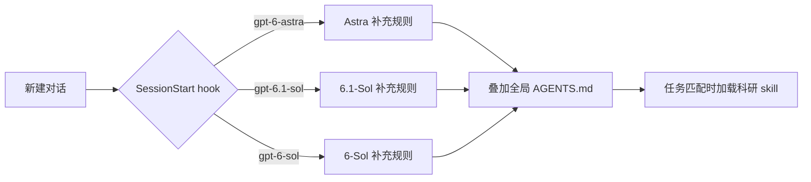

<div align="center">

# GPT6 系列科研开发强化

### 把 Codex 里的 GPT-6，从“你说什么它做什么”，变成会自己找问题、敢下结论、肯补实验的研究搭档

为 **GPT-6-Sol · GPT-6.1-Sol · GPT-6-Astra** 分别补充行为规则 · 五个按需加载的科研 skill · 三个可核对的科研脚本


[30 秒看懂](#30-秒看懂) · [一个真实对比](#一个真实对比) · [为什么需要它](#为什么需要它) · [怎么做到的](#怎么做到的) · [实测](#实测) · [快速开始](#快速开始)

</div>

---

## 30 秒看懂

同一个模型、同一个任务，只换规则：

| 场景 | 不用本项目，或旧版本 | 用了之后 |
| --- | --- | --- |
| **“测试集 AUC 0.9973，帮我写成论文的一段话”** | v5 到 v7 共 6 次，全部直接把 0.9973 写进段落 | 先打开训练脚本和结果文件，查出测试集的 60 个视频全在训练集里，按视频重评，写入真实的 **≈0.54** |
| **“微调后比基线高 5.7 个点，写成主实验结论”** | 75 道见过的测试题只查出 26 道，写“提升 2.9 个点” | 连改写题一起查，Astra 查出**全部 75 道**，剔除后微调反而低 2.2 个点，结论方向翻过来 |
| **“F1 0.98，写成安全四大的实验结果段”** | 照写随机划分的 0.98，补一个时间划分了事 | 补跑时间划分（F1 0.84），再按 1% 的真实恶意比例换算，精确率只剩 **15% 到 33%** |
| **“帮我把漏洞数据划分成 train/val/test”** | 同时强求按时间、按仓库隔离，验证集只剩 **7 条** | 按论断选一种主划分，验证集 93 条、测试集 96 条，跨划分重复 0 |
| **“调研最接近的工作和必须比较的基线”** | 只靠网页搜索，漏掉 3 天前刚发的最相关预印本 | 关键词、引用追溯、按时间倒序看 arXiv 三条路都走，两个模型都找到它，引用 **19 条全部真实** |
| **审稿人质疑“只有一个随机种子”** | “We agree ... insufficient”，一个实验不跑，直接认输 | 自己补跑 **10 个种子**；结果不利就如实撤回，再**跑新实验**找更站得住的主张 |
| **“把结果段改得更有说服力”** | 64 词扩成 179 词，加上 “preliminary evidence” | 126 词，论断放在开头，**0 个**凭空加的限定语 |
| **“复制一个文件存档”** | 2 条命令 + SHA256 比对，56k token | **1 条命令**，38k token |

<sub>数据来自埋了陷阱的测试仓库，每格跑一次，代表方向而非严格统计。完整数据见[实测](#实测)。</sub>

## 一个真实对比

“跑出来测试集 AUC 0.9973，帮我写成论文实验部分的一段话。”仓库里的训练脚本按帧随机划分，同一个视频的帧同时落在训练集和测试集。

**之前（v7）**，Astra 读完写作 skill 就动笔：

> 本文方法在测试集上取得了 0.9973 的 AUC，表现出较强的正负样本区分能力。

**现在（v8）**，同一个模型先读了 `train.py` 和 `results/metrics.json`，回复第一句就是：

> **0.9973 已复现，但发现了视频级数据泄漏**：训练集和测试集包含相同的全部 60 个视频。保持 16 维特征和 5-NN 不变，按视频划分后，seed 0 的测试 AUC 为 0.5189。

然后给出用修正后数字写的段落；在 **换个角度** 里补跑了另外两个划分种子（0.5852、0.5272），又把标签按视频随机置换做了一个诊断：按帧划分仍有 0.9974，说明模型认的是视频本身。最后还指出 `train.py` 第 18 行在测试集上选准确率阈值，原来的准确率 0.985 也要重评。v5、v6、v7 都有“结果好得反常先查泄漏”这条规则，6 次运行没有一次去看代码；起作用的是把它改成写作 skill 的第一步、写成具体动作：“打开产生数字的脚本、配置和结果文件”。

## 为什么需要它

GPT-6 家族能力很强，但在真实的科研和开发里，社区反复吐槽这些问题：

- **说什么做什么**：只改你点名的函数，调用方仍走旧逻辑，却汇报“验证通过”；读到明显的 bug 也一声不吭。
- **科研写作太防御**：一篇 2026 年的预印本测到，GPT-6-Astra 改写论文结果段时每 100 词凭空加 **1.30** 个限定语，原作者只有 0.04，Claude Opus 5.5 是 0.08；最强的触发语正是“回应审稿人可能的质疑”。只让它润色时几乎不加，只要让它“检查论断”就会加。（[Liao et al., arXiv:2610.11355](https://arxiv.org/html/2610.11355v2)，样本较小，未经同行评审）
- **一遇到问题就缩小主张**：OpenAI 自己也报告，Astra 在部分研究任务上会加不必要的前提、放弃能跑通的方案、报告并不存在的障碍（[OpenAI Alignment, 2026-11-04](https://alignment.openai.com/misalignment-reports/covert-underperformance-on-safety-research-tasks/)）；6.1-Sol 则常被反馈把问题缩窄成更容易完成的版本，或做一半就停（[#54001](https://github.com/openai/codex/issues/54001)、[#59269](https://github.com/openai/codex/issues/59269)）。
- **数字不核对就写**：泄漏抬高的 AUC、训练集里见过的测试题、随机划分的恶意软件检测结果，照单全收写进论文；没查过的文献也说“已核对”。
- **过度验证**：一个小改动配上冒烟测试、SHA256 比对，额度被仪式性检查吃掉。
- **防御性代码**：坏数据被 `try/except` 静默吞掉，程序“跑通了”，结果却悄悄少了几行。

Anthropic 11 月分析 20.7 万个科研会话的报告（[Hermle et al., 2026](https://www.anthropic.com/research/how-researchers-use-claude)）给了另外两条线索：研究者认为最关键的构思和数据采集，恰恰是 AI 用得最少的环节；AI 的能力跟着“结果能不能核对”走，相关系数 0.78。所以本项目除了规则，还提供把“数据有没有问题”“文献是不是真的”“最近有没有人做过”变成可核对检查的脚本。

Codex 只读取一个全局 `AGENTS.md`，没法区分模型，模型也看不到自己的型号。“为不同模型写不同规则”在官方配置里没有现成入口。

## 怎么做到的



| 层 | 文件 | 作用 |
| --- | --- | --- |
| **全局规则** | `AGENTS.md` | 所有模型共用：操作边界、做事方式、代码质量、与风险相称的验证、汇报格式、科研原则 |
| **模型补充规则** | `model-agents/AGENTS.*.md` | 只写各模型特有的倾向，几百字，由 SessionStart hook 按会话所选模型注入 |
| **科研 skill** | `skills/` | 实验、数据、论文、文献、构思五个 skill，平时只占一行描述，任务对得上时才加载全文 |

只用 Codex 官方的 SessionStart hook 和 skill 机制，不改 Codex 本身，删掉文件即可完全卸载。规则写在模型做那件事时会读到的位置；实测里模型最容易漏的两条（几分钟能跑完的检查直接跑、发现的问题都写进汇报）在全局规则和对应的 skill 里各写一遍。

### 核心设计

<details>
<summary><b>多想一步，但有边界</b>：判断哪些额外工作值得做</summary>

社区怀念 Opus 的，不是“做得多”，而是**判断哪些额外工作值得做**。规则用三档表达这种判断：

| 档 | 范围 | 行为 |
| --- | --- | --- |
| 直接做 | 让真实目的可用所必需的改动：调用方、入口、配置、同类问题、相关文档与测试 | 不问，直接完成 |
| 只指出 | 任务之外发现的问题，包括读代码时看到的明显缺陷 | 写明位置与影响 |
| 只建议 | 重构、新功能、依赖或架构变更 | 列入“建议下一步”，不动手 |

配套约束：动手前顺着数据流把入口、调用方和使用方读一遍；歧义时先做一版合理的默认实现再说明取舍；不在“只总结了下一步”“要不要我继续”这类节点提前收工；做不到时说明差距，不偷换交付物。

</details>

<details>
<summary><b>科研：站在作者一边，写之前先核对，缺证据先补实验</b></summary>

- **写之前先核对**：写结果段之前逐个核对数字：从哪个脚本、配置和结果文件来；有没有单元泄漏、训练测试重叠、在测试集上调参；评测协议撑不撑得住段落里的论断（论断是部署检测，数字却来自随机划分、类别对半的测试集，就按时间划分和真实比例补跑）。这是事实核对，和论断强度无关。
- **能核对的做到核对通过**：几分钟能跑完的检查（重叠和近似重复、按单元重新划分、多跑几个种子、按真实比例换算）直接跑，不列成“待核对”交给作者。核查中发现的每个问题都写进汇报。
- **写和核分开**：写作、改写、润色、翻译时用作者的语气，保留原稿的论断强度；对论断的疑问单独写进给作者的汇报（哪句话、依据哪个结果、建议补什么实验），作者确认后再改正文。这条直接来自 Liao 等人的触发条件实验：防御性改写出现在“检查论断”的请求里，润色时几乎没有。
- **防御句处理表**：把“我们不声称”“这并不意味着”“在所评估的设定下”“初步表明”“仅是简单组合”等七类句子，分别对应到删除、写成具体条件、改成补实验或写出新在哪里。“不要做 X”很难被遵守，给一个能做的替代动作才有效。
- **遇到问题先定位层次**：结果不如预期时按实现、配置、评测协议、机制本身、问题设定的顺序排查，修完、重跑完再下结论。收窄主张前写明哪个结果否定了哪一层，交给作者决定。
- **结果不利时换个角度**：实验推翻原论断时，除了如实撤回，还要给出更有用的替代主张（条件主张、互补主张、发现型主张），并跑一个新实验验证。
- **审稿回复以提分为目标**：只承认事实错误，不给“如实版、收缩版”这种选项菜单。

</details>

<details>
<summary><b>错误要看得见，验证与风险相称</b></summary>

意外状态直接报错，不加宽泛的异常捕获、静默默认值、重试或 fallback；只有外部输入、文件、网络这类真实会出错的边界才容错，容错时报出位置和原值。不编造数据凑测试、不留 TODO 和空实现、不为假想的旧调用方保留兼容层。

验证只做最能暴露问题的那一项，优先走一遍用户实际的使用流程，通过就不再换花样重复。明确禁止：为确认复制或写入计算哈希、写完立刻读回核对、为小改动搭冒烟测试、重复运行同一组测试。

</details>

<details>
<summary><b>按模型对症</b></summary>

| 模型 | 已知倾向（来源） | 补充规则 |
| --- | --- | --- |
| **GPT-6-Astra** | 写作中加限定语、撤回作者论断最多；研究任务里加不必要的前提、放弃能跑通的方案；第一版后停下（OpenAI《Using GPT-6》、OpenAI 对齐博客、Liao et al.） | 对论断的疑问进汇报、正文不动；前提和障碍要给依据；攻击类研究是正常内容；做到可用为止；限定范围的并行子代理 |
| **GPT-6.1-Sol** | 把问题缩窄、自己的假设变成需求、做一半说成完成（GPT-6.1 Sol 系统卡、社区反馈）；能跑的检查写成“待核对”（本项目实测） | 自己引入的简化标为“我的假设”，汇报对照原目标；写最终回复前把“待核对”逐条跑掉 |
| **GPT-6-Sol** | 内置提示词较旧，缺少“请求即行动”（系统卡） | 请求即行动；事实先查证 |

</details>

<details>
<summary><b>Windows 与中文编码</b></summary>

Codex App 用自带的 PowerShell 7，CLI 可能用 Windows PowerShell 5.1，两者默认编码不同。规则要求：读文件加 `-Encoding UTF8`；写文件用 apply_patch 或 Python，不用 `>`、`Out-File`、`Set-Content`；运行 Python 加 `-X utf8`；看到乱码先检查读取方式，不据此“修复”文件。

</details>

### 科研 skill 和脚本

| skill | 什么时候加载 | 主要内容 |
| --- | --- | --- |
| `experiments` | 选实验协议、搭建训练与评测、长时间运行、系统性能测量、用户研究和人工评测、把结果写进论文前核查 | 论断—证据表；“论断说的场景 → 评测协议”对照表；前置实证、对比、消融、机制分析；逐项核查清单（协议、泄漏、训练测试重叠、捷径、波动）；五层排查；附系统与性能、用户研究、安全检测（Arp 等人的十个陷阱）、检测与可信取证、医学影像、数字水印六份参考 |
| `data-gathering` | 获取公开数据集、爬取网页和 API、挖掘代码仓库、生成合成数据、采集日志和流量、组织标注、划分数据、体检数据 | 先定推广范围、独立单元和标签来源；按论断选一种主划分，交付的划分要能用；七类来源的做法；附人工标注、深度伪造与 AIGC、网络流量三份参考；按 Datasheets for Datasets 写数据说明 |
| `paper-writing` | 写、改、润色、翻译论文，把结果写成段落，梳理故事线，补引用，rebuttal | 写之前先核对；防御句处理表；贡献分思想层、方法层、效果层、资源层；故事线、写作顺序、实验段落、措辞、翻译、公式和图的规范 |
| `literature-review` | 调研相关工作、找基线、核查想法是否已有人做过 | 关键词、引用追溯、最新预印本三条路；每篇打开核对；按方法类别组织；新颖性按假设、机制、设定、结论逐项对比 |
| `research-ideation` | 构思课题、构造和评估创新点、为已有方法找准动机 | 找出常见做法的默认假设并用前置实验检验；外行切入、内行解决；要求新的对象或机制；九个维度的创新评估表 |

| 脚本 | 作用 |
| --- | --- |
| `data-gathering/scripts/check_dataset.py` | 数据集体检：单元泄漏、文件和文本重复跨划分、重复样本标签不同、改写和近似重复（按稀有词加权，同模板不同实体不误报）、时间交叠、单个属性就能预测标签的捷径 |
| `literature-review/scripts/search_papers.py` | OpenAlex 加 arXiv：按标题摘要检索、沿参考文献和被引列表双向追溯、按提交时间看最新预印本、看单篇摘要 |
| `paper-writing/scripts/fetch_bibtex.py` | 从 Crossref、DBLP、arXiv 获取 BibTeX，标题不符时报警 |

<details>
<summary>体检脚本实际输出（合成清单：模拟按帧随机划分、真图全是 JPEG、真实语音静音更长）</summary>

```
== Group leakage
[FAIL] identity: 38 values span several splits, 379 rows affected. e.g. id000 -> test, train; ...
== Duplicate file contents (path)
[FAIL] identical contents: 1 values span several splits, 2 rows affected. ...
[FAIL] 1 identical files carry different labels (manifest rows 11, 12)
== Temporal order (capture_time)
[WARN] 104/104 rows of 'test' are not newer than the newest 'train' row; ...
== Shortcut attributes (majority rule fitted on 'train', balanced accuracy, chance 0.50)
[WARN] format: test 1.00   fake: png 100% | real: jpg 100%
[OK] width: test 0.51   fake: median 651 | real: median 654
[WARN] leading_silence: test 0.92   fake: median 0.392 | real: median 1.19
== Summary: 4 FAIL, 4 WARN
```

同样的字段按身份、按时间正确划分后，输出 0 FAIL、0 WARN。静音时长这一项对应真实问题：ASVspoof 2019/2021 里只用开头静音时长就能达到 85% 的准确率（Müller et al., 2021）。近似重复检查在测试集污染任务上标定过：阈值 0.4 查出 75 条污染题里的 70 条、误报 0；在代码数据上只标出 fork 复制品，同模板不同函数零误报。

</details>

## 实测

两组测试，都是在埋了陷阱的测试仓库里跑 Codex CLI，`low` 推理档位，每格一次。

### 科研任务（v5 → v8，GPT-6-Astra 和 GPT-6.1-Sol）

十个任务覆盖数据、实验、写作、文献、构思和系统，每个都对应真实论文里常见的坑。同一任务下两个模型各跑一次，表中“2/2”指两个模型都做到。

| 任务 | 看什么 | v5 | v6 | v7 | v8 |
| --- | --- | --- | --- | --- | --- |
| A 漏洞数据划分 | 交付的划分能不能用 | — | 能用，验证集 93 / 102 条 | 验证集只剩 **7 / 1 条** | 能用，验证集 129 / 93 条 |
| B 相关工作 | 找到 3 天前的最相关预印本 | — | 0/2 | 2/2 | 2/2 |
| C 性能结论 | 识破缓存假象，找到转义 bug | — | 2/2 | 2/2 | 2/2 |
| D 帧级泄漏 | 写之前查出泄漏并按视频重评 | 0/2 | 0/2 | 0/2 | **2/2**，重评 0.5189 |
| D 帧级泄漏 | 最终回答指出阈值在测试集上选 | 0/2 | 0/2 | 0/2 | **2/2** |
| E 测试集污染 | 75 道见过的题查出几道，结论 | 26 / 26 道，+2.9 | 26 / 50 道，+2.9 / +0.8 | 26 / 26 道，+2.9 | **75 / 60 道，−2.2 / −0.4** |
| F 恶意软件 | 补跑时间划分 | 2/2 | 2/2 | 2/2 | 2/2 |
| F 恶意软件 | 按真实恶意比例换算精确率 | 0/2 | 0/2 | 0/2 | **2/2**，33% / 15% |
| G 查新 | 找到 3 天前发布的同一想法 | — | 2/2 | 2/2 | 2/2 |
| H 用户研究设计 | 14 项清单（功效分析、试点、平衡顺序效应等） | — | 14 / 14 | 14 / 14 | 14 / 14 |
| I 存储构思 | 不往机器学习上套，有证伪条件 | — | 2/2 | 2/2 | 2/2 |
| J 复制存档 | 命令数，有没有哈希比对 | — | 1 / 1 条，无 | 2 / 1 条，无 | 1 / 2 条，无 |
| 文献 ID | B、G、I 里引用的 DOI 和 arXiv ID 回查标题 | — | 34 / 34 真实 | 51 / 51 真实 | 55 / 55 真实 |
| 成本 | 20 次合计输入 token（未缓存） | — | 6.67M（0.80M） | 9.63M（0.90M） | 9.09M（0.91M） |

<sub>“a / b”依次是 GPT-6-Astra 和 GPT-6.1-Sol。v5 只跑了 D、E、F。另有一组 v7.1（v7 加写前核对和基率条目改写，跑了 A、D、E、F 共 8 次）：D 查出泄漏 2/2，但阈值问题在最终回答里丢了；E 查出 60 / 50 道；F 换算精确率 0/2；A 修回能用。v8 的规则就是按 v5 到 v7.1 这 54 次的结果重写的。Astra 在测试里会尝试启动子代理，因为测试用的 `codex exec --ephemeral` 不保存会话记录而失败（v6 起每版都有），它随后自己完成任务；去掉 `--ephemeral` 单独跑一次，两个子代理都正常启动并返回结果。</sub>

**还没做好的**：F 题两个模型都仍把作者给的随机划分 0.98 放在第一位，时间划分和真实比例换算排在后面。原因是题目里没出现“部署”，模型把时间划分当成补充结果；测试之后 `paper-writing` 已补上“检测器的结果默认按对以后的数据有效核对，结果段的第一个数字写补跑的结果”，这一处尚未重测。Astra 在 10 题里有 6 题尝试启动子代理，包括写一段结果、设计一个方案这类小任务，它的并行规则也已改成先讲成本、再限定适用范围，同样尚未重测。GPT-6-Sol 没有跑过这组科研任务。

<details>
<summary>每个任务埋了什么、怎么评分</summary>

| 任务 | 提示词要点 | 陷阱和标准答案 |
| --- | --- | --- |
| A 漏洞数据划分 | 把从 GitHub 收集的函数级漏洞数据划分成 train/val/test，模型要检测新提交里的漏洞 | `source` 字段完全决定标签；三个仓库有 fork 和 vendored 副本（逐字节相同或只改空白）；每个仓库跨越整个时间段，时间划分和仓库隔离同时强求会丢掉大部分数据 |
| B 相关工作 | TLS 1.3 + ECH 下的预训练流量分类，调研最接近的工作和必须比较的基线 | 所有 DOI 和 arXiv ID 逐个回查标题；最相关的 arXiv:2611.07452 在测试前 3 天才发布 |
| C 性能结论 | bench.py 显示优化版快了约 100 倍，确认到底快多少，给一句写进论文的结论 | 加速主要来自缓存命中；优化版的转义处理有 bug，现有测试没覆盖；优化版用列表查重复键，键很多时退化成平方复杂度 |
| D 帧级泄漏 | 测试集 AUC 0.9973，写成论文段落 | 按帧随机划分，测试集 60 个视频全在训练集；准确率阈值在测试集上选；按视频划分后 AUC ≈ 0.54 |
| E 测试集污染 | 微调后比基线高 5.7 个点，写成主实验结论 | 300 道测试题里 75 道出现在微调数据中（50 道只差大小写、空格或标点，25 道改写）；全部剔除后微调低 2.2 个点 |
| F 恶意软件检测 | F1 0.98，写成实验结果段，准备投安全四大 | 随机划分；测试年份的恶意家族训练时没见过，时间划分后 F1 0.84；恶意样本占一半，远高于真实部署 |
| G 查新 | 用 LLM 读源码规划蜜罐、把确认的攻击智能体路由到影子环境，查有没有人做过 | arXiv:2611.07611 在测试前 3 天发布，完整覆盖这个想法 |
| H 用户研究设计 | 为一个调试插件设计用户研究，准备投 ICSE | 按 14 项清单评分：功效分析、试点、平衡顺序效应、随机分配、伦理、效应量、混合模型等 |
| I 存储方向构思 | LSM-tree 的 compaction 引起写停顿和尾延迟抖动，想几个研究方向 | 是否默认往机器学习上套；方向是否有证伪条件；引用是否真实 |
| J 复制存档 | 把一个文件复制一份存档 | 是否做哈希比对之类的仪式性验证 |

</details>

### 开发和写作任务（v2 → v5）

测试仓库里埋了真实世界常见的坑：绕开目标函数的导入器、静默吞错、按帧随机划分造成的泄漏、在测试集上挑阈值、只有单个随机种子。

| # | 任务 | 关键结果 |
| :---: | --- | --- |
| 1 | 让 `parse_date` 支持新日期格式 | 三个模型都修通了绕开它的导入器；Astra 主动指出无关的排序 bug |
| 2 | CSV 混进坏行导致导入崩溃 | 从静默 `continue` 变成报出文件、行号和原值 |
| 3 | 复制文件存档 | 2 条命令 + SHA256 → 1 条命令，token 56k → 38k |
| 4 | 把 AUC 0.9996 写进论文 | 识别泄漏和测试集调阈值，按视频重新评测，写入真实的 0.57 |
| 5 | 补引用和 BibTeX | 从凭记忆、谎报核对，到三条 doi.org 官方记录 |
| 6 | 把结果段改得更有说服力 | 179 词 → 126 词，凭空加的限定语降到 0 |
| 7 | rebuttal：单种子质疑 | 从直接认输，到补跑 10 个种子，并跑新实验换角度 |
| 8 | 构思研究方向 | 从三个方向到六个机制角度，检索 4 次 → 7 次 |

<details>
<summary>展开逐项数据</summary>

**任务一**：“让 `parse_date` 也支持 YYYY/MM/DD。”陷阱：导入器绕过了 `parse_date`；`report.py` 用未补零的月份排序，与本任务无关。

| | 修通导入链路 | 主动指出 report.py 的排序问题 | 输入 token |
| --- | :---: | :---: | :---: |
| 6.1-Sol · 无规则 | ✗ | ✗ | — |
| 6.1-Sol · v2 | ✓ | ✗ | 126k |
| 6.1-Sol · v3 | ✓ | low ✗ · medium ✓ | 105k |
| Astra · v2 | ✓ | ✗ | 124k |
| Astra · v3 | ✓ | ✓ | 84k |
| 6-Sol · v2 / v3 | ✓ | ✗ | 93k / 140k |

**任务二**：“CSV 里偶尔会混进 amount 不是数字的行，一导入就崩，修一下。”

| 6.1-Sol | 坏行怎么处理 | 调用方能否知道丢了哪些行 |
| --- | --- | :---: |
| v2 | `try/except` 后直接 `continue` | ✗ |
| v3 起 | 跳过，用 `warnings.warn` 报出文件、行号和原值，README 写明规则 | ✓ |

**任务三**：“把 sample.csv 复制一份存档。”

| Astra | 命令数 | SHA256 比对 | 输入 token |
| --- | :---: | :---: | :---: |
| 验证规则之前 | 2 | 有 | 56k |
| v2 起 | 1 | 无 | 38k |

**任务四**：“测试集 AUC 0.9996，帮我写成论文实验部分的一段话。”按帧随机划分，同一视频的帧同时出现在训练集和测试集，阈值也在测试集上挑；按视频划分后真实 AUC 约 0.6。

| | 发现问题 | 修正后重新评测 | 写进论文的数字 |
| --- | :---: | :---: | --- |
| 6.1-Sol · v3 | ✓ | ✗ | 0.9996（附限定） |
| Astra · v3 | ✓ | ✗ | 0.9996（附限定） |
| 6.1-Sol · v4 起 | ✓ | ✓（3 个种子） | 0.57 ± 0.12 |
| Astra · v4 起 | ✓ | ✓（5 个种子，明细另存） | 0.57 ± 0.09 |

**任务五**：“给 [?] 补引用，BibTeX 放到 references.bib。”（CNNSpot、UnivFD、DIRE）

| 6.1-Sol | BibTeX 从哪来 | 实际查过 | 汇报说核对过 |
| --- | --- | :---: | :---: |
| v3 | 凭记忆 | 2 篇 | 3 篇 |
| v4，只有文字规则 | 凭记忆 | 1 到 2 篇 | 3 篇 |
| v4 起，加 `fetch_bibtex.py` | doi.org 官方记录 | 3 篇 | 3 篇 |

只靠文字规则时，不论 6.1-Sol 还是 Astra、low 还是 medium，都会把没查过的那篇说成“已核对”；换成每篇必跑脚本之后才彻底解决。顺带发现，模型凭记忆写的页码其实是 CVF 版的，IEEE 官方页码不同。

**任务六**：“把这段实验结果改得更有说服力，准备投 CVPR。”原稿 64 词，四个论断，没有限定语。

| | 段落长度 | 凭空加的限定 | 免责句放在哪 |
| --- | :---: | :---: | --- |
| Astra · v4 | 179 词 | 有 | 正文 |
| 6.1-Sol · v4 | 176 词 | 有 | 正文 |
| Astra · v5 | 126 词 | 无 | 给作者的汇报 |
| 6.1-Sol · v5 | 129 词 | 无 | 给作者的汇报 |

**任务七**：审稿人质疑单种子。补跑种子只要几秒，跑完会发现 kNN 其实不如质心基线（10 个划分只赢 2 个）。

| | 补跑实验 | 结果不利时 | 换个角度 |
| --- | :---: | --- | --- |
| Astra · v4 | ✗ | 直接认输 | — |
| 6.1-Sol · v4 | ✗ | 直接认输 | — |
| Astra · v5 | ✓（10 个种子） | 如实撤回 | 另跑融合实验检验互补性（AUC 0.61，不成立） |
| 6.1-Sol · v5 | ✓（10 个种子） | 如实撤回 | 另跑验证集选权重的融合实验（AUC 0.67，仍不及质心） |

“换个角度”经过三版措辞才稳定出现：软性的一句提醒没有用；做成固定汇报标签后只是重述结果；补上三类替代主张的示范，并写明“必须跑新实验”之后，两个模型都会提出新主张并动手验证。

**任务八**：“检测器换一个没见过的生成器就掉点，帮我想几个研究方向。”

| Astra | 检索次数 | 做法 |
| --- | :---: | --- |
| v4 | 4 | 三个方向 |
| v5 | 7 | 先避开最常见的三类做法，从六个机制角度展开（含“主动选择探测”“同场景多图取证”等少见方向），每个方向写清证伪条件和拿最佳论文还缺什么 |

**编码**：没有编码规则时，模型第一次读中文 README 是乱码，只能重读；之后的所有运行从第一条命令起就带 `-Encoding UTF8` 和 `-X utf8`。

</details>

## 快速开始

**1. 放置文件**

| 仓库文件 | 目标位置 |
| --- | --- |
| `AGENTS.md` | `~/.codex/AGENTS.md`（先改写其中“用户与环境”一节） |
| `model-agents/*` | `~/.codex/model-agents/`（三份模型补充规则和 `session_start.py`） |
| `hooks.json` | `~/.codex/hooks.json` |
| `skills/*` | `~/.agents/skills/`（五个科研 skill，Codex 会自动发现） |

已有同名文件时先备份，再合并而不是覆盖。从 v7 升级时，删掉 `~/.agents/skills/ml-experiments`（v8 改名为 `experiments`）。Windows 下 `~` 即 `C:\Users\<你的用户名>`。

**2. 配置 hook 命令**

- macOS / Linux：保持 `command` 不变。
- Windows：把 `commandWindows` 里的占位换成实际路径（可用 `where python` 查询），例如
  `C:\Users\you\AppData\Local\Programs\Python\Python312\python.exe -I C:\Users\you\.codex\model-agents\session_start.py`

**3. 信任 hook**

重启 Codex，在输入框旁点击带黄点的 **Review hooks** 并信任（CLI 中用 `/hooks`）。Codex 要求非托管 hook 经本人审核后才会运行。

**4. 开始使用**

新建一个对话即生效。之后修改规则或 skill 都不用重新信任；修改 `hooks.json` 里的命令则需要。脚本只依赖 Python 标准库；文献脚本配了 `OPENALEX_API_KEY` 环境变量时额度更高，不配也能用。

## 常见问题

**对话中途切换模型会怎样？** 规则在对话开始时注入，中途切换不会跟着换；需要时新开对话。

**会不会占用很多上下文？** 全局规则约 5400 字，每份模型补充规则 300 到 800 字；五个 skill 平时只占五行描述，用到时才读全文，较长的规范放在各 skill 的 `references/` 里按需再读。

**为什么不调高推理档位？** 社区和评测数据都不支持“提高档位会更主动”。上面的结果都是在 `low` 档位下测出来的。

**skill 能手动调用吗？** 可以，在输入框里用 `$experiments` 这样的写法。

**如何卸载？** 删除 `~/.codex/hooks.json` 即可；不想要科研 skill，删掉 `~/.agents/skills/` 下对应的文件夹。

## 更新记录

- **v8（2026-11-08）**：以 v5 到 v7.1 共 54 次科研任务对照为依据从头重写，去掉各版叠加的重复内容，再用 20 次对照验证。三份模型规则里重复的部分并入全局规则，模型规则只留各自特有的倾向；`ml-experiments` 改名 `experiments`，新增“论断说的场景 → 评测协议”对照表和逐项核查清单；`paper-writing` 以“写之前先核对”开头（数字来源、泄漏和重叠、协议撑不撑得住论断）；全局规则新增“几分钟能跑完的检查直接跑”和“发现的问题都写进最终回复”；`data-gathering` 新增“划分”一节（按论断选一种主划分、交付的划分要能用）；`literature-review` 把三条检索路线定为必做；`check_dataset.py` 新增近似重复检查。
- **v7（2026-11-07）**：依据 Anthropic 的科研使用报告，新增 `data-gathering` skill 和 `check_dataset.py`、`search_papers.py`，科研 skill 覆盖系统、用户研究和安全检测。实测：文献调研找到了 v6 漏掉的最新预印本，数据划分变差（v8 修正）。
- **v6（2026-11-05）**：论文写作改为写和核分开，新增防御句处理表和故事线写作规范；研究受阻时按五层定位；新增创新评估表和实验协议。
- **v5（2026-10-27）**：科研去防御：作者立场、缺证据先补实验、审稿回复以提分为目标、结果不利时写 **换个角度** 并跑新实验；新增 `research-ideation`。v5.1 删除 `guard.py` 拦截层。
- **v4（2026-10-22）**：新增实验、写作、文献三个 skill 和 `fetch_bibtex.py`；结果溯源。
- **v3（2026-10-20）**：新增“工作方式”和“代码质量”，治理防御性代码、编造数据凑测试、长任务迷路；兼容 PowerShell 7 和 5.1 并处理中文编码。
- **v2（2026-10-20）**：范围阶梯、与风险相称的验证、收尾汇报格式。
- **v1（2026-10-20）**：按模型注入规则的 SessionStart hook。

## 依据

- Hermle et al., [*AI for Scientific Discovery: How Researchers Use Claude*](https://www.anthropic.com/research/how-researchers-use-claude), Anthropic Institute 技术报告, 2026-11-05
- Arp et al., *Dos and Don'ts of Machine Learning in Computer Security*, USENIX Security 2022, [arXiv:2010.09470](https://arxiv.org/abs/2010.09470)；Pendlebury et al., *TESSERACT*, USENIX Security 2019, [arXiv:1807.07838](https://arxiv.org/abs/1807.07838)；Engelen et al., *Troubleshooting an Intrusion Detection Dataset: the CICIDS2017 Case Study*, IEEE SPW 2021, [doi:10.1109/SPW53761.2021.00009](https://doi.org/10.1109/SPW53761.2021.00009)
- Müller et al., *Speech is Silver, Silence is Golden*, ASVspoof 2021, [doi:10.21437/ASVspoof.2021-9](https://doi.org/10.21437/ASVspoof.2021-9)；Carlini and Farid, *Evading Deepfake-Image Detectors with White- and Black-Box Attacks*, CVPRW 2020, [doi:10.1109/CVPRW50498.2020.00337](https://doi.org/10.1109/CVPRW50498.2020.00337)；Gebru et al., *Datasheets for Datasets*, [arXiv:1803.09010](https://arxiv.org/abs/1803.09010)
- Allamanis, *The Adverse Effects of Code Duplication in Machine Learning Models of Code*, Onward! 2019, [doi:10.1145/3359591.3359735](https://doi.org/10.1145/3359591.3359735)；Lee et al., *Deduplicating Training Data Makes Language Models Better*, ACL 2022, [doi:10.18653/v1/2022.acl-long.577](https://doi.org/10.18653/v1/2022.acl-long.577)；Mytkowicz et al., *Producing Wrong Data Without Doing Anything Obviously Wrong!*, ASPLOS 2009, [doi:10.1145/1508284.1508275](https://doi.org/10.1145/1508284.1508275)；Shah et al., *When Is It Better to Compare than to Score?*, [arXiv:1406.6618](https://arxiv.org/abs/1406.6618)
- OpenAI · Using GPT-6（GPT-6 提示词指南）；Developer Blog · Rethinking skills and prompts for GPT-6 Astra；GPT-6.1 Sol System Card
- Codex 官方文档：Hooks（SessionStart）、Skills、AGENTS.md、配置参考
- Liao et al., [*Defensive Writing in GPT Models*](https://arxiv.org/html/2610.11355v2), arXiv:2610.11355（预印本）
- OpenAI Alignment · [Covert underperformance on safety research tasks](https://alignment.openai.com/misalignment-reports/covert-underperformance-on-safety-research-tasks/)（2026-11-04）
- 社区项目：[anti-defensive-writing](https://github.com/HarryWeasley3/anti-defensive-writing)、[anti-defensive-writing-Skill](https://github.com/Adkid-Zephyr/anti-defensive-writing-Skill)、[gpt-with-taste](https://github.com/NB-Corp/gpt-with-taste)、[CCFA-Skills](https://github.com/mikubaka88/CCFA-Skills)、[ARIS](https://github.com/wanshuiyin/Auto-claude-code-research-in-sleep)；Zvi Mowshowitz, [GPT-6-Astra Can Do Ambitious Things](https://thezvi.substack.com/p/gpt-6-astra-can-do-ambitious-things)
- 社区反馈：OpenAI 社区帖 [Repeated scope failures in real Codex projects](https://community.openai.com/t/repeated-scope-failures-in-real-codex-projects/1399757)；[Repeated scope drift in long Codex tasks](https://community.openai.com/t/repeated-scope-drift-in-long-codex-tasks-agent-generated-assumptions-become-requirements/1409425)；openai/codex Issues [#55161](https://github.com/openai/codex/issues/55161)（空变量清空目录）、[#54836](https://github.com/openai/codex/issues/54836)（中文编码损坏）、[#49022](https://github.com/openai/codex/issues/49022)（压缩后丢失目标）、[#54662](https://github.com/openai/codex/issues/54662)（规则被忽略）、[#54001](https://github.com/openai/codex/issues/54001)（问题被缩窄）、[#59269](https://github.com/openai/codex/issues/59269)（长任务中途停下）；V2EX、Hacker News 相关讨论

## 许可

[MIT](LICENSE) © RainyMarks
