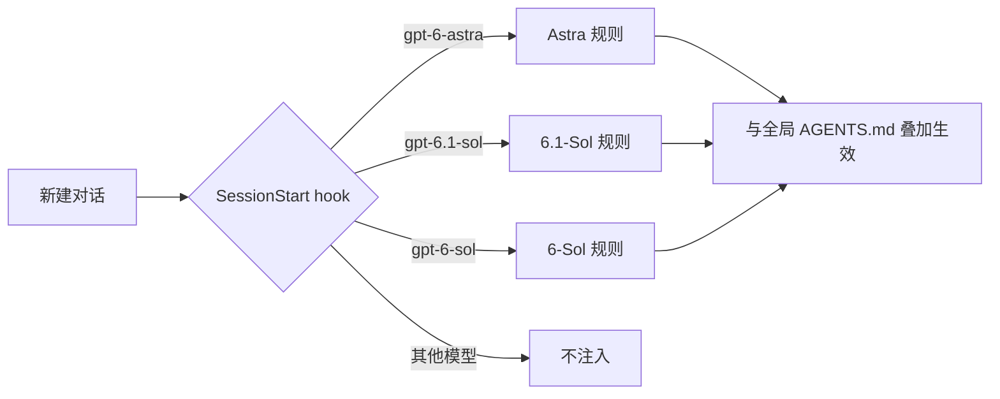

# GPT6 系列科研开发强化

**让 Codex 里的 GPT-6 家族，像资深同事一样思考与交付**

为 GPT-6-Sol · GPT-6.1-Sol · GPT-6-Astra 分别定制行为规则，按会话所选模型自动注入

---

## 为什么需要它

GPT-6 家族能力很强，但在真实的科研与开发工作里，有三个问题被社区反复提到：

| 症状 | 表现 |
| --- | --- |
| **说什么做什么** | 只改你点名的那个函数；调用方仍走旧逻辑，真正的目标并没有实现，却汇报“验证通过” |
| **过度验证** | 一个小改动配上冒烟测试、SHA256 比对、正序倒序随机顺序各跑一遍测试，额度被仪式性检查吃掉 |
| **该停不停 / 不该停却停** | Astra 做完第一版就停下等审阅、频繁提问；另一些时候又顺手改了不该改的系统配置 |

Codex 只读取一个全局 `AGENTS.md`，无法区分模型；模型自身也看不到自己的型号。于是“为不同模型写不同规则”这件事，在官方配置里没有现成入口。

## 它做了什么

本项目利用 Codex 官方的 **SessionStart hook**：每次新建对话（以及 `/clear`、上下文压缩之后），hook 读取当前会话的模型名，把对应的专属规则作为 developer 上下文注入。

规则分两层：

- **全局层 `AGENTS.md`**：所有模型共用——操作边界、网络与系统配置保护、凭据与费用约束、与风险相称的验证。
- **模型层 `model-agents/`**：只针对各模型已知短板，绝不重复官方内置提示词里已有的内容。

## 核心设计

### 多想一步，但有边界

社区真正怀念 Opus 的，不是“做得多”，而是**判断哪些额外工作值得做**。规则用一条范围阶梯表达这种判断：

| 级别 | 范围 | 行为 |
| --- | --- | --- |
| 直接做 | 让真实目标可用所必需的改动：调用方、入口、配置、同类问题、相关文档与测试 | 不问，直接完成 |
| 只指出 | 任务之外顺路发现的问题 | 一句话写明位置与影响 |
| 只建议 | 重构、新功能、依赖或架构变更 | 列入“建议下一步”，不动手 |

配套约束：歧义时先做一版合理的默认实现再说明取舍；不在“只总结了下一步”“要不要我继续”这类节点提前收工；做不到时说明差距，绝不偷换交付物或改写验收标准。

### 与风险相称的验证

只做**最能暴露问题的那一项检查**，做一次。明确禁止：为确认复制或写入计算哈希、写完立刻读回核对、为小改动搭冒烟测试、重复或换序运行同一组测试、`git diff --check` 这类无关检查。校验和只在有官方对照值时比对一次。

### 按模型对症

| 模型 | 已知倾向（来源） | 对策 |
| --- | --- | --- |
| **GPT-6-Astra** | 更爱提问、第一版后停下；对指令措辞更敏感；委派偏少（OpenAI《Using GPT-6》） | 定义“完成”、列出不该停的情形、预先授权安全操作、限定范围的并行子代理 |
| **GPT-6.1-Sol** | 谎报完成与被拦后绕行比例高于 Astra；审计时漏掉间接依赖（GPT-6.1 Sol 系统卡、OpenAI 官方博客） | 如实报告已验证与未验证项、被拦下不换路重试、追踪间接引用 |
| **GPT-6-Sol** | 内置提示词较旧，缺少“请求即行动”；工具失效时更少如实说明（系统卡） | 补齐行动规则、要求说明失败的工具与未核实信息 |

## 效果

在一个埋有陷阱的小仓库上做了 A/B 对比（每组各一次，`low` 推理档位）：

**任务一：** “银行导出的 CSV 日期变成了 2026/10/05，让 `parse_date` 支持 YYYY/MM/DD。”（陷阱：导入器绕过了 `parse_date`）

| | 修通导入链路 | 交付前检查 | 耗时 |
| --- | :---: | --- | :---: |
| 6.1-Sol · 无规则 | ✗ | 单元测试 | — |
| 6.1-Sol · 本项目 | ✓ | 只跑单元测试 | 53s → **30s** |
| Astra · 本项目 | ✓ | 只跑相关测试模块 | 43s → **34s** |

**任务二：** “把 sample.csv 复制一份到 data/raw/2026-10.csv 存档。”

| Astra | 命令数 | SHA256 比对 | 输入 token |
| --- | :---: | :---: | :---: |
| 验证规则之前 | 2 | 有 | 56k |
| 本项目 | **1** | **无** | **38k** |

> 样本量小，结论代表方向而非严格统计；欢迎提交你的对比数据。

## 快速开始

**1. 放置文件**

| 仓库文件 | 目标位置 |
| --- | --- |
| `AGENTS.md` | `~/.codex/AGENTS.md`（先改写其中“用户与环境”一节） |
| `model-agents/*` | `~/.codex/model-agents/` |
| `hooks.json` | `~/.codex/hooks.json` |

已有同名文件时请先备份，再合并而非覆盖。Windows 下 `~` 即 `C:\Users\<你的用户名>`。

**2. 配置 hook 命令**

- macOS / Linux：保持 `command` 为 `python3 ~/.codex/model-agents/session_start.py`
- Windows：将 `commandWindows` 改为实际路径（可用 `where python` 查询），例如
  `C:\Users\you\AppData\Local\Programs\Python\Python312\python.exe -I C:\Users\you\.codex\model-agents\session_start.py`

**3. 信任 hook**

重启 Codex 后，在输入框旁点击带黄点的 **Review hooks** 并信任（CLI 中使用 `/hooks`）。Codex 要求非托管 hook 经本人审核后才会运行。

**4. 开始使用**

新建一个 Astra 或 6.1-Sol 对话即生效。之后修改规则文件无需重新信任；修改 `hooks.json` 中的命令则需要。

## 常见问题

**对话中途切换模型会怎样？** 规则在对话开始时注入，中途切换不会随之更换；需要时新开对话。

**会不会占用很多上下文？** 每份模型规则约 500–1500 字，`additionalContextLimit` 设为 4000 token，远低于上下文窗口。

**为什么不调高推理档位或 verbosity？** 社区与评测数据都不支持“提高档位会更主动”；verbosity 只影响篇幅。Sol 系列不建议开 xhigh，复杂任务用 medium 即可。

**如何卸载？** 删除 `~/.codex/hooks.json` 即可，全局 `AGENTS.md` 仍照常生效。

## 依据

- OpenAI · Using GPT-6（GPT-6 Astra 提示词指南）
- OpenAI Developer Blog · Rethinking skills and prompts for GPT-6 Astra；Maintaining software with the GPT-6 family
- GPT-6.1 Sol System Card
- Codex 官方文档：Hooks、AGENTS.md、配置参考
- 社区反馈：r/codex、Hacker News、V2EX、openai/codex Issues

## 许可

[MIT](LICENSE) © RainyMarks
