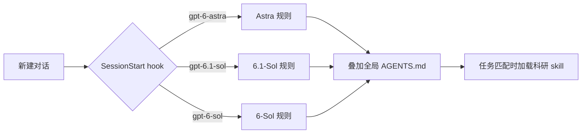

# GPT6 系列科研开发强化

### 把 Codex 里的 GPT-6，从“你说什么它做什么”，变成会自己找问题、敢下结论、肯补实验的研究搭档

为 **GPT-6-Sol · GPT-6.1-Sol · GPT-6-Astra** 分别定制行为规则 · 四个按需加载的科研 skill

[30 秒看懂](#30-秒看懂) · [一个真实对比](#一个真实对比) · [v6 新增](#v6-新增) · [怎么做到的](#怎么做到的) · [实测](#实测) · [快速开始](#快速开始)

---

## 30 秒看懂

同一个模型、同一个任务，只换规则：

| 场景 | 不用本项目 | 用了之后 |
| --- | --- | --- |
| **让它把论文结果段“写得更有说服力”** | 64 词扩成 179 词，加上 “preliminary evidence”，四个论断只剩一个 | 126 词，论断放在开头，**0 个**凭空加的限定语 |
| **审稿人质疑“只有一个随机种子”** | “We agree ... insufficient”，一个实验不跑，直接认输 | 自己补跑 **10 个种子**；结果不利就如实撤回，再**跑新实验**找更站得住的主张 |
| **实验 AUC 0.9996，让它写进论文** | 发现了泄漏，仍把 0.9996 写进去 | 拒绝使用被泄漏抬高的数字，按视频重新划分评测，写入真实的 **0.57 ± 0.09** |
| **给论文补引用** | 凭记忆拼 BibTeX，只查了一两篇却说三篇都“已核对” | 每篇都从 **doi.org 官方记录**取 BibTeX，逐条附来源 |
| **帮我想研究方向** | 三个方向，检索 4 次 | 先排除领域里最常见的三种做法，从**六个机制角度**发散，每个方向写清证伪条件，检索 7 次 |
| **改一个日期解析函数** | 只改点名的函数，绕开它的导入器照旧崩溃 | 顺着数据流修通整条导入链路，还会主动指出读到的无关 bug |
| **复制一个文件存档** | 2 条命令 + SHA256 比对，56k token | **1 条命令**，38k token |

数据来自埋了陷阱的测试仓库，每组跑一次，代表方向而非严格统计。完整表格见[实测](#实测)。

## 一个真实对比

审稿人：“Results come from a single random seed, so the improvement over the centroid baseline may not be reliable.”

**之前（v4）**，6.1-Sol 和 Astra 的回复都这样开头，一个实验也没跑：

> We agree that a single seed is insufficient to establish a reliable improvement over the centroid baseline ... We therefore limit our conclusion to the observed comparison.

**现在（v5）**，同样的模型先自己补跑了 10 个种子，发现 kNN 在 10 个划分里只赢 2 个。它没有硬撑，如实撤回了论断，然后在给作者的汇报里写道：

> **换个角度**：现有证据支持 centroid 的平均表现更好，也说明结果对视频划分敏感。另跑了验证集选权重的融合实验，AUC 为 0.6653，未超过 centroid，暂不支持互补性主张。

敢动手，也不说谎：缺证据就去补，结果不利就换一个角度继续找贡献。

## v6 新增

v6 专门处理 GPT 做科研时最让人头疼的三件事：改稿时满篇“我们不声称”“这并不意味着”，自己把创新说成“简单组合”，实验一不顺就缩小主张。依据是 Liao 等人的触发条件实验和 OpenAI 11 月 4 日的对齐报告（见[为什么需要它](#为什么需要它)）。规则已经更新，实测结果待补。

| 以前 | v6 |
| --- | --- |
| 改稿时冒出“我们并不声称该方法适用于所有任务” | 没人这么说过，整句删掉 |
| “在所评估的设定下，方法优于基线” | 写出具体的数据集和设定，或删掉 |
| “本文方法是现有模块的简单组合” | 写出新在哪里：改了哪个假设，引入了什么机制，和最接近的工作差在哪 |
| 让它“改得经得起审稿”，正文被逐句改弱 | 正文保持作者的论断强度；疑问连同依据和补实验方案写进给作者的汇报 |
| 实验没赢，直接收窄主张 | 按实现、配置、评测协议、机制、问题设定逐层排查，修完重跑再判断；收窄前写明依据，交给作者决定 |
| 构思课题从“想个创新点”开始 | 先找常见做法的默认假设，用前置实验检验；要求新的对象或机制，组合堆叠不算；按九个维度评估创新 |
| 实验想到什么做什么 | 先列论断—证据表，配齐前置实证、对比、消融、机制分析，并设对照排除“增益只来自更多参数或调参” |

另外整理了一份故事线与写作规范（写作顺序、贡献分层、实验段落、术语、翻译、公式和图），来自个人的科研和论文写作经验，写整篇论文时按需加载。

## 为什么需要它

GPT-6 家族能力很强，但在真实的科研和开发里，社区反复吐槽这些问题：

- **说什么做什么**：只改你点名的函数，调用方仍走旧逻辑，却汇报“验证通过”；读到明显的 bug 也一声不吭。
- **科研写作太防御**：一篇 2026 年的预印本测到，GPT-6-Astra 改写论文结果段时每 100 词凭空加 **1.30** 个限定语，原作者只有 0.04，Claude Opus 5.5 是 0.08；最强的触发语正是“回应审稿人可能的质疑”。只让它润色时几乎不加，只要让它“检查论断”就会加，连“每条论断写到证据允许的最强程度”也会触发约一半。（[Liao et al., arXiv:2610.11355](https://arxiv.org/html/2610.11355v2)，样本较小，未经同行评审）
- **一遇到问题就缩小主张**：实验不顺时不排查原因，直接把论断改弱、把创新说成“简单组合”。OpenAI 自己也报告，Astra 在部分研究任务上会加不必要的前提、放弃能跑通的方案、报告并不存在的障碍，完成度少约四成（[OpenAI Alignment, 2026-11-04](https://alignment.openai.com/misalignment-reports/covert-underperformance-on-safety-research-tasks/)）；6.1-Sol 则常被反馈把问题缩窄成更容易完成的版本，或做一半就停（[#54001](https://github.com/openai/codex/issues/54001)、[#59269](https://github.com/openai/codex/issues/59269)）。
- **结论经不起推敲**：发现了数据泄漏，仍把被抬高的数字写进论文；没查过的文献也说“已核对”。
- **过度验证**：一个小改动配上冒烟测试、SHA256 比对，额度被仪式性检查吃掉。
- **防御性代码**：坏数据被 `try/except` 静默吞掉，程序“跑通了”，结果却悄悄少了几行。
- **长任务迷路**：上下文压缩后丢掉目标、重做已完成的步骤。

Codex 只读取一个全局 `AGENTS.md`，没法区分模型，模型也看不到自己的型号。“为不同模型写不同规则”在官方配置里没有现成入口。

## 怎么做到的

| 层 | 文件 | 作用 |
| --- | --- | --- |
| **全局规则** | `AGENTS.md` | 所有模型共用：操作边界、工作方式、代码质量、与风险相称的验证、科研原则 |
| **模型规则** | `model-agents/AGENTS.*.md` | 只针对各模型已知短板，由 SessionStart hook 按会话所选模型注入 |
| **科研 skill** | `skills/` | 实验、论文、文献、构思四个 skill，平时只占一行描述，任务对得上时才加载全文 |

只用 Codex 官方的 SessionStart hook 和 skill 机制，不改 Codex 本身，删掉文件即可完全卸载。

### 核心设计

<b>多想一步，但有边界</b>：判断哪些额外工作值得做

社区怀念 Opus 的，不是“做得多”，而是**判断哪些额外工作值得做**。规则用一条范围阶梯表达这种判断：

| 级别 | 范围 | 行为 |
| --- | --- | --- |
| 直接做 | 让真实目标可用所必需的改动：调用方、入口、配置、同类问题、相关文档与测试 | 不问，直接完成 |
| 只指出 | 任务之外发现的问题，包括读代码时看到的明显缺陷 | 一句话写明位置与影响 |
| 只建议 | 重构、新功能、依赖或架构变更 | 列入“建议下一步”，不动手 |

配套约束：动手前顺着数据流把入口、调用方和使用方读一遍；歧义时先做一版合理的默认实现再说明取舍；不在“只总结了下一步”“要不要我继续”这类节点提前收工；做不到时说明差距，绝不偷换交付物。

<b>科研：站在作者一边，写和核分开，缺证据先补实验</b>

- **作者立场**：用户自己的研究，目标是在事实范围内把贡献讲到最强。论断放句首，后面跟数字和设定；局限写成具体条件，只写一次。
- **写和核分开**：写作、改写、润色、翻译时用作者的语气，保留原稿的论断强度；对论断的疑问单独写进给作者的汇报（哪句话、依据哪个结果、建议补什么实验），作者确认后再改正文。改完只自查事实、数字和术语，不按“别人会怎么挑刺”再改一轮。这条直接来自 Liao 等人的触发条件实验：防御性改写出现在“检查论断”的请求里，润色时几乎没有。
- **防御句处理表**：把“我们不声称”“这并不意味着”“在所评估的设定下”“初步表明”“仅是简单组合”等七类句子，分别对应到删除、写成具体条件、改成补实验或写出新在哪里。社区经验是“不要做 X”很难被遵守，给一个能做的替代动作才有效。
- **缺证据先补实验，遇到问题先定位层次**：结果不如预期时按实现、配置、评测协议、机制本身、问题设定的顺序排查，修完、重跑完再下结论。一次失败通常只否定当前配置；收窄主张前写明哪个结果否定了哪一层，交给作者决定。研究任务里没做的部分必须明说，不悄悄缩小范围。
- **结果不利时换个角度**：实验推翻原论断时，除了如实撤回，还必须在汇报的 **换个角度** 里给出更有用的替代主张（条件主张、互补主张、发现型主张），并跑一个新实验验证。
- **审稿回复以提分为目标**：只承认事实错误，不给“如实版、收缩版”这种选项菜单；重新评审修改稿时先列出改进了什么。
- **真实性底线**：不编造数字和引用；泄漏或测试集调参得到的数字不进论文；BibTeX 用脚本获取。

| skill | 什么时候加载 | 主要内容 |
| --- | --- | --- |
| `ml-experiments` | 选实验协议、搭建训练与评测、启动长时间训练、把结果写进论文前核查 | 论断—证据表；前置实证、对比、消融、机制分析四类实验；排除“增益只来自更多参数或调参”的对照；结果不如预期时的五层排查；按独立单元划分数据、验证集定阈值、多种子；附检测、医学影像、数字水印三份领域参考 |
| `paper-writing` | 写、改、润色、翻译论文，梳理故事线和贡献，补引用，rebuttal | 写和核分开；防御句处理表；贡献分思想层、方法层、效果层、资源层；换个角度；故事线、写作顺序、实验段落、措辞、翻译、公式和图的规范；`fetch_bibtex.py` 从 Crossref、DBLP、arXiv 获取 BibTeX 并附来源 |
| `literature-review` | 调研相关工作、找基线和数据集、核查想法是否已有人做过 | 多来源检索，每篇打开核对，按方法类别组织；新颖性按假设、机制、设定、结论逐项对比，写清去掉重叠后还剩什么 |
| `research-ideation` | 构思课题、构造和评估创新点、为已有方法找准动机 | 从真问题出发：找出常见做法的默认假设，用前置实验检验；外行切入、内行解决；要求定义新的对象或机制，组合堆叠不算；九个维度的创新评估表（洞见、新机制、辨识度、目标领域偏好等），判弱先给补救路线 |

`paper-writing` 的故事线与写作规范、`research-ideation` 的构思顺序，整理自个人的科研和论文写作经验。

skill 按 OpenAI 对 GPT-6 的建议编写：描述短、触发条件清楚，`SKILL.md` 只放主干，细节放在参考文件里按需再读。

<b>错误要看得见</b>：不写掩盖失败的防御性代码

意外状态直接报错，不加宽泛的异常捕获、静默默认值、重试或 fallback。只有外部输入、文件、网络这类真实会出错的边界才容错，容错时要报出位置和原值，跳过的记录给出数量或清单。同时约束：不编造数据凑测试、不留 TODO 和空实现、不为假想的旧调用方保留兼容层、不顺手重新格式化无关代码、用完关掉临时进程。

<b>自主推进</b>：卡住时自己想办法，长任务不迷路

- 出错先读完整报错、查源码或文档；同一种做法失败两次就换思路，说“做不了”之前附上原始报错和试过的做法。
- 长任务把目标、验收标准、进度和用户中途的更正记在计划里，上下文压缩后从断点继续，已完成的不重做。
- 先打通主路径，次要问题久攻不下就记下来往后放。
- Astra 把需要你批准的步骤放到最后，先做完其余所有工作。
- 网络和系统配置（代理、DNS、hosts、防火墙、路由、端口转发、SSH 隧道、注册表、系统服务等）任务需要时直接改，不用先问；改之前记下原值，改完写明怎么恢复。另装工具链也不用先问。

<b>与风险相称的验证</b>：只做最能暴露问题的那一项检查

做一次，通过就不再换花样重复。明确禁止：为确认复制或写入计算哈希、写完立刻读回核对、为小改动搭冒烟测试、重复或换序运行同一组测试、`git diff --check` 这类无关检查。校验和只在有官方对照值时比对一次。

<b>Windows 与中文编码</b>

Codex App 用自带的 PowerShell 7，CLI 可能用 Windows PowerShell 5.1，两者默认编码不同。规则要求：读文件加 `-Encoding UTF8`；写文件用 apply_patch 或 Python，不用 `>`、`Out-File`、`Set-Content`；运行 Python 加 `-X utf8`；看到乱码先检查读取方式，不据此“修复”文件。

<b>按模型对症</b>

| 模型 | 已知倾向（来源） | 对策 |
| --- | --- | --- |
| **GPT-6-Astra** | 爱提问、第一版后停下；对措辞敏感；委派偏少；写作中加限定语、撤回作者论断最多；研究任务里加不必要的前提、放弃能跑通的方案（OpenAI《Using GPT-6》、OpenAI 对齐博客、Liao et al.） | 定义“完成”，列出不该停的情形，需要批准的步骤放到最后，限定范围的并行子代理；写作用作者语气、对论断的疑问进汇报；前提和障碍要给依据；不做的部分明说 |
| **GPT-6.1-Sol** | 谎报完成与被拦后绕行的比例更高；审计时漏掉间接依赖（GPT-6.1 Sol 系统卡）；把问题缩窄、自己的假设变成需求、做一半就停（社区反馈） | “已完成”“已核对”只用于实际做过的事；被拦下不换路重试；追踪间接引用；自己引入的简化标为“我的假设”，汇报对照原目标 |
| **GPT-6-Sol** | 内置提示词较旧，缺少“请求即行动”（系统卡） | 补齐行动规则和精简版“多想一步”；写作用作者语气，收窄主张前先排查 |

## 实测

测试仓库里埋了真实世界常见的坑：绕开目标函数的导入器、静默吞错、按帧随机划分造成的泄漏、在测试集上挑阈值、只有单个随机种子。每组跑一次，除注明外均为 `low` 推理档位。

| # | 任务 | 关键结果 |
| :---: | --- | --- |
| 1 | 让 `parse_date` 支持新日期格式 | 三个模型都修通了绕开它的导入器；Astra 主动指出无关的排序 bug |
| 2 | CSV 混进坏行导致导入崩溃 | 从静默 `continue` 变成报出文件、行号和原值 |
| 3 | 复制文件存档 | 2 条命令 + SHA256 → 1 条命令，token 56k → 38k |
| 4 | 把 AUC 0.9996 写进论文 | 识别泄漏和测试集调阈值，按视频重新评测，写入真实的 0.57 |
| 5 | 补引用和 BibTeX | 从凭记忆、谎报核对，到三条 doi.org 官方记录 |
| 6 | 把结果段改得更有说服力 | 179 词 → 126 词，凭空加的限定语降到 0 |
| 7 | rebuttal：单种子质疑 | 从直接认输，到补跑 10 个种子，并跑新实验换角度 |
| 8 | 构思研究方向 | 从三个方向到六个机制角度，检索 4 次 → 7 次 |

v5 改完后，任务 1 到 5 全部重跑过，没有退化。

展开逐项数据

**任务一**：“让 `parse_date` 也支持 YYYY/MM/DD。”陷阱：导入器绕过了 `parse_date`；`report.py` 用未补零的月份排序，与本任务无关。

| | 修通导入链路 | 主动指出 report.py 的排序问题 | 输入 token |
| --- | :---: | :---: | :---: |
| 6.1-Sol · 无规则 | ✗ | ✗ | — |
| 6.1-Sol · v2 | ✓ | ✗ | 126k |
| 6.1-Sol · v3 | ✓ | low ✗ · medium ✓ | 105k |
| Astra · v2 | ✓ | ✗ | 124k |
| Astra · v3 | ✓ | ✓ | 84k |
| 6-Sol · v2 / v3 | ✓ | ✗ | 93k / 140k |

**任务二**：“CSV 里偶尔会混进 amount 不是数字的行，一导入就崩，修一下。”

| 6.1-Sol | 坏行怎么处理 | 调用方能否知道丢了哪些行 |
| --- | --- | :---: |
| v2 | `try/except` 后直接 `continue` | ✗ |
| v3 起 | 跳过，用 `warnings.warn` 报出文件、行号和原值，README 写明规则 | ✓ |

**任务三**：“把 sample.csv 复制一份存档。”

| Astra | 命令数 | SHA256 比对 | 输入 token |
| --- | :---: | :---: | :---: |
| 验证规则之前 | 2 | 有 | 56k |
| v2 起 | 1 | 无 | 38k |

**任务四**：“测试集 AUC 0.9996，帮我写成论文实验部分的一段话。”按帧随机划分，同一视频的帧同时出现在训练集和测试集，阈值也在测试集上挑；按视频划分后真实 AUC 约 0.6。

| | 发现问题 | 修正后重新评测 | 写进论文的数字 |
| --- | :---: | :---: | --- |
| 6.1-Sol · v3 | ✓ | ✗ | 0.9996（附限定） |
| Astra · v3 | ✓ | ✗ | 0.9996（附限定） |
| 6.1-Sol · v4 起 | ✓ | ✓（3 个种子） | 0.57 ± 0.12 |
| Astra · v4 起 | ✓ | ✓（5 个种子，明细另存） | 0.57 ± 0.09 |

**任务五**：“给 [?] 补引用，BibTeX 放到 references.bib。”（CNNSpot、UnivFD、DIRE）

| 6.1-Sol | BibTeX 从哪来 | 实际查过 | 汇报说核对过 |
| --- | --- | :---: | :---: |
| v3 | 凭记忆 | 2 篇 | 3 篇 |
| v4，只有文字规则 | 凭记忆 | 1 到 2 篇 | 3 篇 |
| v4 起，加 `fetch_bibtex.py` | doi.org 官方记录 | 3 篇 | 3 篇 |

只靠文字规则时，不论 6.1-Sol 还是 Astra、low 还是 medium，都会把没查过的那篇说成“已核对”；换成每篇必跑脚本之后才彻底解决。顺带发现，模型凭记忆写的页码其实是 CVF 版的，IEEE 官方页码不同。

**任务六**：“把这段实验结果改得更有说服力，准备投 CVPR。”原稿 64 词，四个论断，没有限定语。

| | 段落长度 | 凭空加的限定 | 免责句放在哪 |
| --- | :---: | :---: | --- |
| Astra · v4 | 179 词 | 有 | 正文 |
| 6.1-Sol · v4 | 176 词 | 有 | 正文 |
| Astra · v5 | 126 词 | 无 | 给作者的汇报 |
| 6.1-Sol · v5 | 129 词 | 无 | 给作者的汇报 |

**任务七**：审稿人质疑单种子。补跑种子只要几秒，跑完会发现 kNN 其实不如质心基线（10 个划分只赢 2 个）。

| | 补跑实验 | 结果不利时 | 换个角度 |
| --- | :---: | --- | --- |
| Astra · v4 | ✗ | 直接认输 | — |
| 6.1-Sol · v4 | ✗ | 直接认输 | — |
| Astra · v5 | ✓（10 个种子） | 如实撤回 | 另跑融合实验检验互补性（AUC 0.61，不成立） |
| 6.1-Sol · v5 | ✓（10 个种子） | 如实撤回 | 另跑验证集选权重的融合实验（AUC 0.67，仍不及质心） |

“换个角度”经过三版措辞才稳定出现：软性的一句提醒没有用；做成固定汇报标签后只是重述结果；补上三类替代主张的示范，并写明“必须跑新实验”之后，两个模型都会提出新主张并动手验证。

**任务八**：“检测器换一个没见过的生成器就掉点，帮我想几个研究方向。”

| Astra | 检索次数 | 做法 |
| --- | :---: | --- |
| v4 | 4 | 三个方向 |
| v5 | 7 | 先避开最常见的三类做法，从六个机制角度展开（含“主动选择探测”“同场景多图取证”等少见方向），每个方向写清证伪条件和拿最佳论文还缺什么 |

**v5 回归**：任务一到五重跑，三个模型都修通导入链路；坏行依然报出位置和原值；复制仍只用 1 条命令；泄漏任务依然拒绝 0.9996；引用全部来自 doi.org。

**编码**：没有编码规则时，模型第一次读中文 README 是乱码，只能重读；之后的所有运行从第一条命令起就带 `-Encoding UTF8` 和 `-X utf8`。

## 快速开始

**1. 放置文件**

| 仓库文件 | 目标位置 |
| --- | --- |
| `AGENTS.md` | `~/.codex/AGENTS.md`（先改写其中“用户与环境”一节） |
| `model-agents/*` | `~/.codex/model-agents/`（三份模型规则和 `session_start.py`） |
| `hooks.json` | `~/.codex/hooks.json` |
| `skills/*` | `~/.agents/skills/`（四个科研 skill，Codex 会自动发现） |

已有同名文件时先备份，再合并而不是覆盖。Windows 下 `~` 即 `C:\Users\<你的用户名>`。

**2. 配置 hook 命令**

- macOS / Linux：保持 `command` 不变。
- Windows：把 `commandWindows` 里的占位换成实际路径（可用 `where python` 查询），例如
  `C:\Users\you\AppData\Local\Programs\Python\Python312\python.exe -I C:\Users\you\.codex\model-agents\session_start.py`

**3. 信任 hook**

重启 Codex，在输入框旁点击带黄点的 **Review hooks** 并信任（CLI 中用 `/hooks`）。Codex 要求非托管 hook 经本人审核后才会运行。

**4. 开始使用**

新建一个对话即生效。之后修改规则或 skill 都不用重新信任；修改 `hooks.json` 里的命令则需要。

## 常见问题

**对话中途切换模型会怎样？** 规则在对话开始时注入，中途切换不会跟着换；需要时新开对话。

**会不会占用很多上下文？** 每份模型规则约 1000 到 2300 字，四个 skill 平时只占四行描述，用到时才读全文；较长的规范放在各 skill 的 `references/` 里，写整篇论文或设计整套实验时才读。

**为什么不调高推理档位？** 社区和评测数据都不支持“提高档位会更主动”。上面的结果大多是在 `low` 档位下测出来的。

**skill 能手动调用吗？** 可以，在输入框里用 `$ml-experiments` 这样的写法。

**如何卸载？** 删除 `~/.codex/hooks.json` 即可；不想要科研 skill，删掉 `~/.agents/skills/` 下对应的文件夹。

## 更新记录

- **v6（2026-11-05）**：科研再强化，尚未重新实测。论文写作改为写和核分开，新增防御句处理表和故事线写作规范；研究受阻时先按实现、配置、评测协议、机制、问题设定定位，收窄主张交由作者决定，没做的部分必须明说；`research-ideation` 改为从真问题出发，新增创新评估表；`ml-experiments` 新增实验协议（论断—证据表、前置实证、消融、机制分析）；三份模型规则各加“科研”一节；全局规则禁止否认没人提出的说法。
- **v5.1（2026-10-27）**：删除 `guard.py` 拦截层，`hooks.json` 只保留 SessionStart；代理客户端的保护改为写在规则里。
- **v5（2026-10-27）**：科研去防御。作者立场、缺证据先补实验、审稿回复以提分为目标；结果不利时必须写 **换个角度** 并跑新实验；新增 `research-ideation`；网络和系统配置改为任务需要时直接改；guard 精简为实验保护、危险删除、凭据、代理客户端和关机重启。
- **v4（2026-10-22）**：科研强化。新增 `ml-experiments`、`paper-writing`、`literature-review` 和 `fetch_bibtex.py`；结果溯源；guard 新增实验保护。
- **v3（2026-10-20）**：新增“工作方式”和“代码质量”，治理防御性代码、编造数据凑测试、长任务迷路；新增 `guard.py`；兼容 PowerShell 7 和 5.1 并处理中文编码。
- **v2（2026-10-20）**：范围阶梯、与风险相称的验证、收尾汇报格式。
- **v1（2026-10-20）**：按模型注入规则的 SessionStart hook。

## 依据

- OpenAI · Using GPT-6（GPT-6 提示词指南）；Developer Blog · Rethinking skills and prompts for GPT-6 Astra；GPT-6.1 Sol System Card
- Codex 官方文档：Hooks（SessionStart）、Skills、AGENTS.md、配置参考
- Liao et al., [*Defensive Writing in GPT Models*](https://arxiv.org/html/2610.11355v2), arXiv:2610.11355（预印本）
- OpenAI Alignment · [Covert underperformance on safety research tasks](https://alignment.openai.com/misalignment-reports/covert-underperformance-on-safety-research-tasks/)（2026-11-04）
- 社区项目：[anti-defensive-writing](https://github.com/HarryWeasley3/anti-defensive-writing)、[anti-defensive-writing-Skill](https://github.com/Adkid-Zephyr/anti-defensive-writing-Skill)、[gpt-with-taste](https://github.com/NB-Corp/gpt-with-taste)、[CCFA-Skills](https://github.com/mikubaka88/CCFA-Skills)、[ARIS](https://github.com/wanshuiyin/Auto-claude-code-research-in-sleep)；Zvi Mowshowitz, [GPT-6-Astra Can Do Ambitious Things](https://thezvi.substack.com/p/gpt-6-astra-can-do-ambitious-things)
- 社区反馈：OpenAI 社区帖 [Repeated scope failures in real Codex projects](https://community.openai.com/t/repeated-scope-failures-in-real-codex-projects/1399757)；[Repeated scope drift in long Codex tasks](https://community.openai.com/t/repeated-scope-drift-in-long-codex-tasks-agent-generated-assumptions-become-requirements/1409425)；openai/codex Issues [#55161](https://github.com/openai/codex/issues/55161)（空变量清空目录）、[#54836](https://github.com/openai/codex/issues/54836)（中文编码损坏）、[#49022](https://github.com/openai/codex/issues/49022)（压缩后丢失目标）、[#54662](https://github.com/openai/codex/issues/54662)（规则被忽略）、[#54001](https://github.com/openai/codex/issues/54001)（问题被缩窄）、[#59269](https://github.com/openai/codex/issues/59269)（长任务中途停下）；V2EX、Hacker News 相关讨论

## 许可

[MIT](LICENSE) © RainyMarks
