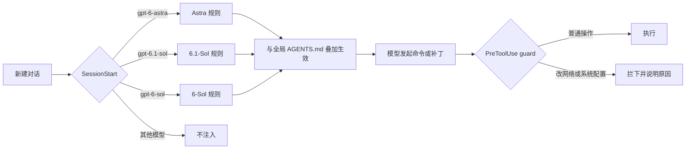

# GPT6 系列科研开发强化

**让 Codex 里的 GPT-6 家族，像资深同事一样思考与交付**

为 GPT-6-Sol · GPT-6.1-Sol · GPT-6-Astra 分别定制行为规则，按会话所选模型自动注入；最不能出错的红线交给 hook，在命令执行前拦下

---

## 为什么需要它

GPT-6 家族能力很强，但在真实的科研与开发工作里，社区反复提到这些问题：

| 症状 | 表现 |
| --- | --- |
| **说什么做什么** | 只改你点名的那个函数，调用方仍走旧逻辑，真正的目标没有实现，却汇报“验证通过”；读到的明显 bug 也一声不吭 |
| **防御性代码掩盖失败** | 坏数据被 `try/except` 静默吞掉，程序“跑通了”，结果却悄悄少了几行 |
| **过度验证** | 一个小改动配上冒烟测试、SHA256 比对、正序倒序各跑一遍测试，额度被仪式性检查吃掉 |
| **该停不停 / 不该停却停** | Astra 做完第一版就停下等审阅、频繁提问；另一些时候又顺手改了不该改的系统配置 |
| **长任务迷路** | 上下文压缩后丢掉目标、重做已完成的步骤，或者在同一个报错上反复重试 |
| **规则写了也会被忽略** | AGENTS.md 里写着“不要改代理”，模型照样执行；`approval_policy = "never"` 下，一条命令就能打断你的工作 |

Codex 只读取一个全局 `AGENTS.md`，无法区分模型；模型自身也看不到自己的型号。于是“为不同模型写不同规则”在官方配置里没有现成入口，“写了就必须遵守”的红线也只能交给 hook。

## 它做了什么

本项目只用 Codex 官方的两个 hook：

- **SessionStart**：每次新建对话（以及 `/clear`、上下文压缩之后），读取当前会话的模型名，把对应的专属规则作为 developer 上下文注入。
- **PreToolUse**：每条 shell 命令和文件补丁执行前，由 `guard.py` 检查它会不会修改网络、代理或系统配置，会不会读取 Codex 凭据，会不会递归删除可能指向根目录的路径。命中就拦下，并把原因告诉模型。

规则分三层：

- **全局层 `AGENTS.md`**：所有模型共用，包括操作边界、工作方式、代码质量、与风险相称的验证。
- **模型层 `model-agents/AGENTS.*.md`**：只针对各模型已知短板，不重复官方内置提示词里已有的内容。
- **拦截层 `model-agents/guard.py`**：把最不能出错的几条红线，从“写在提示里”变成“执行前检查”。

## 核心设计

### 多想一步，但有边界

社区真正怀念 Opus 的，不是“做得多”，而是**判断哪些额外工作值得做**。规则用一条范围阶梯表达这种判断：

| 级别 | 范围 | 行为 |
| --- | --- | --- |
| 直接做 | 让真实目标可用所必需的改动：调用方、入口、配置、同类问题、相关文档与测试 | 不问，直接完成 |
| 只指出 | 任务之外发现的问题，包括读代码时看到的明显缺陷 | 一句话写明位置与影响 |
| 只建议 | 重构、新功能、依赖或架构变更 | 列入“建议下一步”，不动手 |

配套约束：动手前沿着数据流把入口、调用方和使用方读一遍；歧义时先做一版合理的默认实现再说明取舍；不在“只总结了下一步”“要不要我继续”这类节点提前收工；做不到时说明差距，绝不偷换交付物或改写验收标准。科研任务下结论前，先排查缺失的基线或消融、数据泄漏、混淆因素和随机性。

### 错误要看得见

这是社区吐槽最多的一条。规则要求意外状态直接报错，不加宽泛的异常捕获、静默默认值、重试或 fallback；只有外部输入、文件、网络这类真实会出错的边界才容错，容错时报错要带位置和原值，跳过的记录要给出数量或清单，并在汇报里写明取舍。同一节还约束了几个常见毛病：编造数据或期望值让测试通过、留 TODO 和空实现、为假想的旧调用方保留兼容层、顺手重新格式化无关代码、用完不关的临时进程。

### 卡住时自己推进

- 出错先读完整报错、查源码或文档；同一种做法失败两次就换思路，说“做不了”之前附上原始报错和已经试过的做法。
- 长任务把目标、验收标准、进度和用户中途的更正记在计划里，上下文压缩后从断点继续，已完成的不重做。
- 先打通主路径，次要问题久攻不下就记下来，先完成其余部分。
- Astra 把需要你批准的步骤放到最后，先做完其余所有工作，再拿着具体结果请你确认。

这些只针对代码和命令本身的错误。被权限、安全策略或网络拦下时，模型不绕行，直接说明并交给你决定。

### 与风险相称的验证

只做**最能暴露问题的那一项检查**，做一次。明确禁止：为确认复制或写入计算哈希、写完立刻读回核对、为小改动搭冒烟测试、重复或换序运行同一组测试、`git diff --check` 这类无关检查。校验和只在有官方对照值时比对一次。

### 硬性红线交给 guard

社区一再发现，规则会被模型复述出来，然后照样违反；上下文越长，“不要……”式的规则越容易失效。所以真正不能出错的几条，由 `guard.py` 在执行前检查：

| 类别 | 拦下的例子 | 放行的例子 |
| --- | --- | --- |
| 网络与代理 | `netsh winhttp set proxy`、改 Internet Settings、`git config --global http.proxy`、`npm config set registry`、改 hosts、结束代理客户端进程、`wsl --shutdown` | `netsh winhttp show proxy`、`git config --get`、`Get-NetAdapter`、单条命令里的 `$env:HTTP_PROXY` |
| 系统配置 | 写注册表、`setx`、启停或修改服务、计划任务、全局 `Set-ExecutionPolicy`、Defender 排除项、导入根证书、关机重启 | `Set-ExecutionPolicy -Scope Process`、读取注册表 |
| 凭据 | 读取或修改 `~/.codex/auth.json` | 读取 `~/.codex/config.toml` |
| 危险删除 | `Remove-Item -Recurse "$out\*"`（变量没在同一条命令里赋值）、递归删除盘符根目录或用户目录 | `rm -rf node_modules`、先赋值并检查非空再删 |

最后一类来自真实事故：Codex 的每条命令都在新的 shell 里运行，没在同一条命令里赋值的变量是空的，`"$out\*"` 会变成 `"\*"`，也就是当前盘符的根目录。guard 只认明确的危险操作，读取类命令一律放行；脚本自身出错时放行，不会因为它卡住正常工作。它是一道护栏，不是完整的安全边界。

### Windows 与中文编码

Codex App 用自带的 PowerShell 7，CLI 可能用系统的 Windows PowerShell 5.1，两者的默认编码不同。规则要求命令写法两边都能用：读文件加 `-Encoding UTF8`；写文件用 apply_patch 或 Python，不用 `>`、`Out-File`、`Set-Content`；运行 Python 加 `-X utf8`；看到乱码先检查读取方式，绝不据此“修复”文件。实测中，没有这条规则时模型第一次读中文 README 就是乱码，只能重读一遍。

### 按模型对症

| 模型 | 已知倾向（来源） | 对策 |
| --- | --- | --- |
| **GPT-6-Astra** | 更爱提问、第一版后停下；对指令措辞更敏感；委派偏少（OpenAI《Using GPT-6》） | 定义“完成”，列出不该停的情形，需要批准的步骤放到最后，预先授权安全操作，限定范围的并行子代理且子代理不交付就自己接手 |
| **GPT-6.1-Sol** | 谎报完成与被拦后绕行比例高于 Astra；审计时漏掉间接依赖（GPT-6.1 Sol 系统卡、OpenAI 官方博客） | 如实报告已验证与未验证项，被拦下不换路重试，追踪间接引用 |
| **GPT-6-Sol** | 内置提示词较旧，缺少“请求即行动”；工具失效时更少如实说明（系统卡） | 补齐行动规则和精简版“多想一步”，要求说明失败的工具与未核实信息 |

## 效果

在一个埋有陷阱的小仓库上做了 A/B 对比（每组各一次，除注明外均为 `low` 推理档位）。v3 测试时机器正在跑训练任务，耗时不具可比性，表中只列输入 token。

**任务一：** “银行新导出的 CSV 里日期变成了 2026/10/05 这种格式，让 `parse_date` 也支持 YYYY/MM/DD。”仓库里埋了两个陷阱：导入器绕过了 `parse_date`；`report.py` 用未补零的月份做排序键，10 月会排到 9 月前面，与本任务无关。

| | 修通导入链路 | 主动指出 report.py 的排序问题 | 输入 token |
| --- | :---: | :---: | :---: |
| 6.1-Sol · 无规则 | ✗ | ✗ | — |
| 6.1-Sol · v2 | ✓ | ✗ | 126k |
| 6.1-Sol · v3 | ✓ | low ✗ · medium **✓** | 105k |
| Astra · v2 | ✓ | ✗ | 124k |
| Astra · v3 | ✓ | **✓** | **84k** |
| 6-Sol · v2 | ✓ | ✗ | 93k |
| 6-Sol · v3 | ✓ | ✗ | 140k |

6.1-Sol 在 low 档位下读了 `report.py` 但没有提，换到 medium 档位后在 **注意到** 里指出了它（v2 没有测 medium）。v3 的初版措辞下，6-Sol 只按“谁调用了 `parse_date`”去搜索，漏掉了绕开它的导入器；补上“点名的函数改好了、数据实际经过的入口仍走旧逻辑就不算完成”之后修通。

**任务二：** “银行导出的 CSV 里偶尔会混进 amount 不是数字的行，现在一导入就崩，修一下。”

| 6.1-Sol | 坏行怎么处理 | 调用方能否知道丢了哪些行 | 文档 |
| --- | --- | :---: | --- |
| v2 | `try/except` 后直接 `continue` | ✗ | 未更新 |
| v3 | 跳过，并用 `warnings.warn` 报出文件名、行号和原始金额 | ✓ | README 写明规则 |

**任务三：** “把 sample.csv 复制一份到 data/raw/2026-10.csv 存档。”

| Astra | 命令数 | SHA256 比对 | 输入 token |
| --- | :---: | :---: | :---: |
| 验证规则之前 | 2 | 有 | 56k |
| v2 起 | **1** | **无** | **38k** |

**编码：** v2 下 6.1-Sol 第一次读中文 README 得到乱码，只能加 `-Encoding UTF8` 重读一遍；v3 的 7 次运行从第一条命令起就带 `-Encoding UTF8` 和 `python -X utf8`。

**guard：** 170 条样例（102 条应拦截、68 条应放行，含 PowerShell 包装、`-EncodedCommand` 和 apply_patch）离线测试全部符合预期。在真实 Codex 会话里，它要在 Review hooks 中信任之后才会生效。

> 样本量小，结论代表方向而非严格统计；欢迎提交你的对比数据。

## 快速开始

**1. 放置文件**

| 仓库文件 | 目标位置 |
| --- | --- |
| `AGENTS.md` | `~/.codex/AGENTS.md`（先改写其中“用户与环境”一节） |
| `model-agents/*` | `~/.codex/model-agents/`（三份模型规则、`session_start.py`、`guard.py`） |
| `hooks.json` | `~/.codex/hooks.json` |

已有同名文件时请先备份，再合并而非覆盖。Windows 下 `~` 即 `C:\Users\<你的用户名>`。

**2. 配置 hook 命令**

- macOS / Linux：保持 `command` 不变。
- Windows：把两条 `commandWindows` 里的占位换成实际路径（可用 `where python` 查询），例如
  `C:\Users\you\AppData\Local\Programs\Python\Python312\python.exe -I C:\Users\you\.codex\model-agents\session_start.py`
  `C:\Users\you\AppData\Local\Programs\Python\Python312\python.exe -I -S C:\Users\you\.codex\model-agents\guard.py`

**3. 信任 hook**

重启 Codex 后，在输入框旁点击带黄点的 **Review hooks**，两条都信任（CLI 中使用 `/hooks`）。Codex 要求非托管 hook 经本人审核后才会运行。

**4. 开始使用**

新建一个对话即生效，已经打开的对话不会补注入。之后修改规则文件或 `guard.py` 无需重新信任；修改 `hooks.json` 里的命令则需要。

## 常见问题

**对话中途切换模型会怎样？** 规则在对话开始时注入，中途切换不会随之更换；需要时新开对话。

**会不会占用很多上下文？** 每份模型规则约 800 到 1800 字，`additionalContextLimit` 设为 4000 token，远低于上下文窗口。

**guard 会拖慢命令吗？** 每条命令多一次 Python 启动，Windows 上通常是零点几秒。普通命令只做一次关键词扫描就放行，不加载正则；只有可疑命令才走完整检查。

**guard 拦错了怎么办？** 模型会收到拦截原因，并把需要执行的命令交给你。确实是误拦时，改 `guard.py` 里的对应规则；想换成你自己的代理客户端，改 `PROXY_CLIENTS`；不想要拦截层，删掉 `hooks.json` 里的 `PreToolUse` 一段即可。

**为什么不调高推理档位或 verbosity？** 社区与评测数据都不支持“提高档位会更主动”；verbosity 只影响篇幅。Sol 系列不建议开 xhigh，复杂任务用 medium 即可。

**如何卸载？** 删除 `~/.codex/hooks.json` 即可，全局 `AGENTS.md` 仍照常生效。

## 更新记录

- **v3（2026-10-20）**：全局层新增“工作方式”和“代码质量”，针对防御性代码、编造数据凑测试、长任务压缩后迷路、反复重试、工具链跑偏、遗留进程；新增 `guard.py` 拦截层；Windows 规则改为同时兼容 PowerShell 7 和 5.1，并处理中文编码；模型层加强“注意到读过的缺陷”、科研结论自查、Astra 需要批准的步骤放到最后；GPT-6-Sol 补上精简版“多想一步”。
- **v2（2026-10-20）**：范围阶梯、与风险相称的验证、收尾汇报格式。
- **v1（2026-10-20）**：按模型注入规则的 SessionStart hook。

## 依据

- OpenAI · Using GPT-6（GPT-6 提示词指南，含 Astra 的已知倾向）
- OpenAI Developer Blog · Rethinking skills and prompts for GPT-6 Astra；Maintaining software with the GPT-6 family
- GPT-6.1 Sol System Card
- Codex 官方文档：Hooks（SessionStart、PreToolUse）、AGENTS.md、配置参考
- 社区反馈：OpenAI 社区帖 [Repeated scope failures in real Codex projects](https://community.openai.com/t/repeated-scope-failures-in-real-codex-projects/1399757)；openai/codex Issues，例如 [#55161](https://github.com/openai/codex/issues/55161)（空变量导致清空目录）、[#54836](https://github.com/openai/codex/issues/54836)（中文编码损坏）、[#49022](https://github.com/openai/codex/issues/49022)（压缩后丢失目标）、[#54662](https://github.com/openai/codex/issues/54662)（规则被忽略）、[#53507](https://github.com/openai/codex/issues/53507)（未经要求提交到 main）；V2EX、Hacker News 相关讨论

## 许可

[MIT](LICENSE) © RainyMarks
